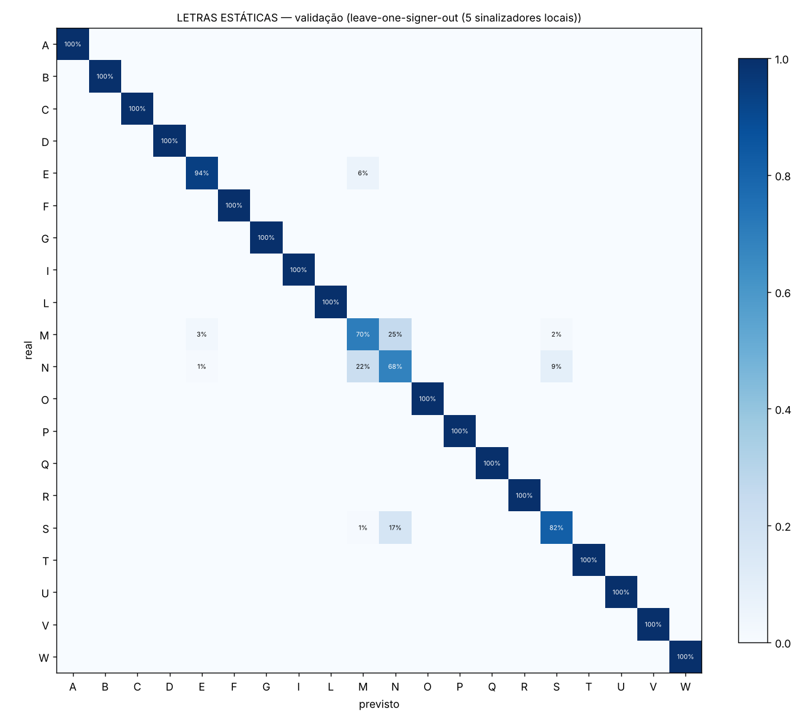
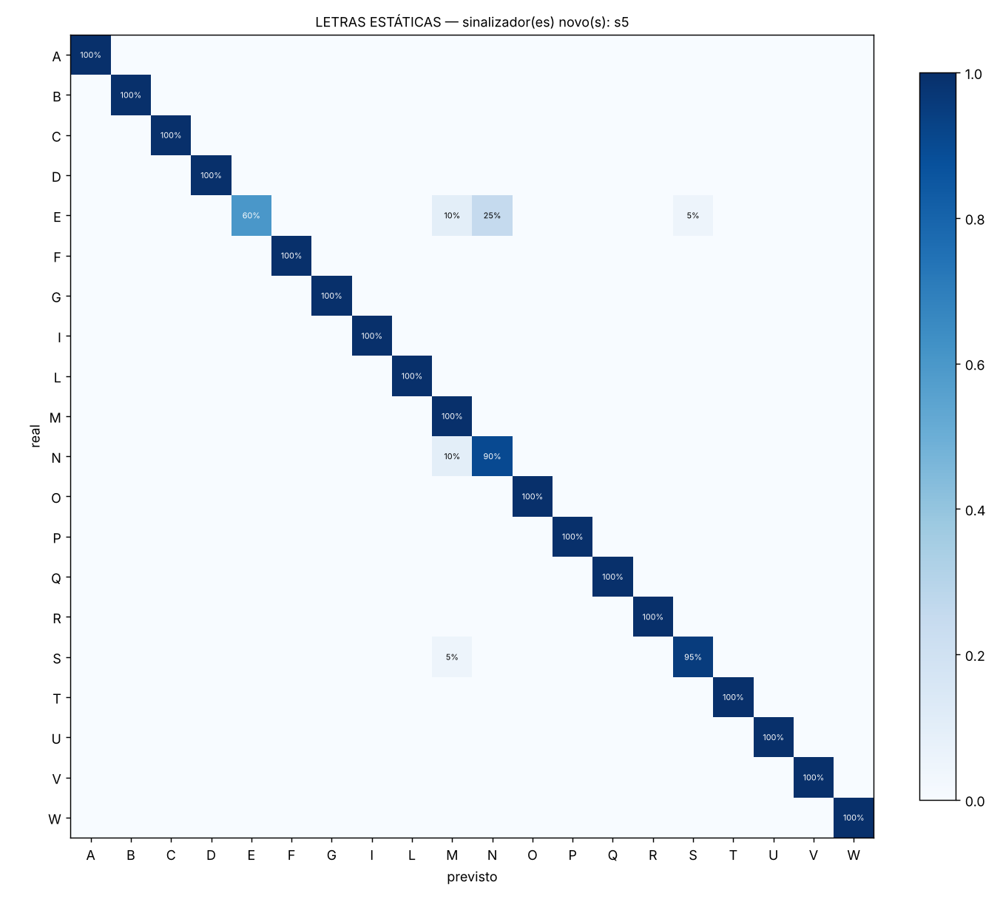
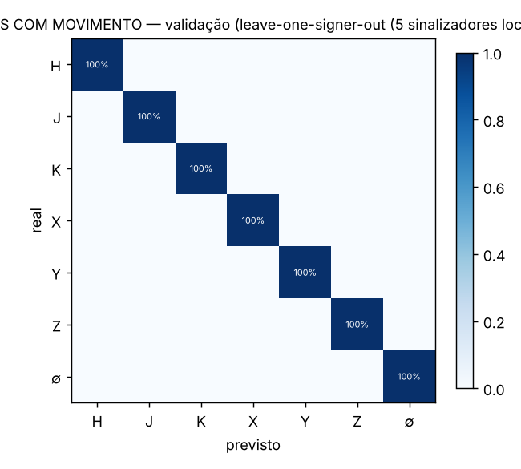
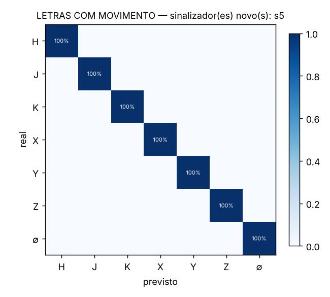

# Relatório — tradutor de datilologia em LIBRAS

> **Exemplo gerado com dados SINTÉTICOS** (`python -m libras.sintetico`). Mostra o formato do relatório; os números não representam LIBRAS real.
Gerado em 26/10/2026 23:07. Sinalizador(es) de teste: **s5**. Aumentos por amostra: 5.

## Letras estáticas

Validação: leave-one-signer-out (5 sinalizadores locais). Sinalizadores: s0, s1, s2, s3, s4.

**Comparação de modelos (acurácia balanceada | pior letra):**

- svm_rbf: 96.1% | 58.0%
- extra_trees: 95.7% | 68.0%  ← escolhido
- mlp: 95.9% | 65.0%
- logistica: 95.7% | 62.0%

**Armadilha da mesma pessoa:** divisão aleatória 98.4% vs pessoa nova 95.7% (diferença +2.7%). A divisão aleatória superestima o desempenho.

**Limiar de REPITA O SINAL:** 0.30 → responde em 95.3% das tentativas, acertando 97.7% delas (alvo 95%).

### Acurácia por letra — validação (pessoa fora do treino)

| letra | amostras | acuracia_letra | precisao | f1 | mais_confundida_com |
|---|---|---|---|---|---|
| A | 100 | 100.0% | 100.0% | 100.0% | — |
| B | 100 | 100.0% | 100.0% | 100.0% | — |
| C | 100 | 100.0% | 100.0% | 100.0% | — |
| D | 100 | 100.0% | 100.0% | 100.0% | — |
| E | 100 | 94.0% | 95.9% | 94.9% | M (6%) |
| F | 100 | 100.0% | 100.0% | 100.0% | — |
| G | 100 | 100.0% | 100.0% | 100.0% | — |
| I | 100 | 100.0% | 100.0% | 100.0% | — |
| L | 100 | 100.0% | 100.0% | 100.0% | — |
| M | 100 | 70.0% | 70.7% | 70.4% | N (25%) |
| N | 100 | 68.0% | 61.8% | 64.8% | M (22%) |
| O | 100 | 100.0% | 100.0% | 100.0% | — |
| P | 100 | 100.0% | 100.0% | 100.0% | — |
| Q | 100 | 100.0% | 100.0% | 100.0% | — |
| R | 100 | 100.0% | 100.0% | 100.0% | — |
| S | 100 | 82.0% | 88.2% | 85.0% | N (17%) |
| T | 100 | 100.0% | 100.0% | 100.0% | — |
| U | 100 | 100.0% | 100.0% | 100.0% | — |
| V | 100 | 100.0% | 100.0% | 100.0% | — |
| W | 100 | 100.0% | 100.0% | 100.0% | — |

### Por sinalizador (cada um avaliado com modelo que não o viu)

| sinalizador | amostras | acuracia | acuracia_balanceada |
|---|---|---|---|
| s0 | 400 | 98.0% | 98.0% |
| s1 | 400 | 95.8% | 95.7% |
| s2 | 400 | 92.5% | 92.5% |
| s3 | 400 | 96.2% | 96.2% |
| s4 | 400 | 96.0% | 96.0% |

### Grupos confundíveis

**Grupo A/S/E**

| real \ previsto | A | S | E | outras |
|---|---|---|---|---|
| A | 100 | 0 | 0 | 0 |
| S | 0 | 82 | 0 | 18 |
| E | 0 | 0 | 94 | 6 |

**Grupo M/N**

| real \ previsto | M | N | outras |
|---|---|---|---|
| M | 70 | 25 | 5 |
| N | 22 | 68 | 10 |

**Grupo U/V/R**

| real \ previsto | U | V | R | outras |
|---|---|---|---|---|
| U | 100 | 0 | 0 | 0 |
| V | 0 | 100 | 0 | 0 |
| R | 0 | 0 | 100 | 0 |

**Grupo F/T**

| real \ previsto | F | T | outras |
|---|---|---|---|
| F | 100 | 0 | 0 |
| T | 0 | 100 | 0 |

**Grupo O/C**

| real \ previsto | O | C | outras |
|---|---|---|---|
| O | 100 | 0 | 0 |
| C | 0 | 100 | 0 |

**Grupo G/Q**

| real \ previsto | G | Q | outras |
|---|---|---|---|
| G | 100 | 0 | 0 |
| Q | 0 | 100 | 0 |

### Sinalizador(es) nunca vistos: s5

Acurácia 97.2% | balanceada 97.3% | com rejeição: responde 94.8%, acerta 99.7%.

| letra | amostras | acuracia_letra | precisao | f1 | mais_confundida_com |
|---|---|---|---|---|---|
| A | 20 | 100.0% | 100.0% | 100.0% | — |
| B | 20 | 100.0% | 100.0% | 100.0% | — |
| C | 20 | 100.0% | 100.0% | 100.0% | — |
| D | 20 | 100.0% | 100.0% | 100.0% | — |
| E | 20 | 60.0% | 100.0% | 75.0% | N (25%) |
| F | 20 | 100.0% | 100.0% | 100.0% | — |
| G | 20 | 100.0% | 100.0% | 100.0% | — |
| I | 20 | 100.0% | 100.0% | 100.0% | — |
| L | 20 | 100.0% | 100.0% | 100.0% | — |
| M | 20 | 100.0% | 80.0% | 88.9% | — |
| N | 20 | 90.0% | 78.3% | 83.7% | M (10%) |
| O | 20 | 100.0% | 100.0% | 100.0% | — |
| P | 20 | 100.0% | 100.0% | 100.0% | — |
| Q | 20 | 100.0% | 100.0% | 100.0% | — |
| R | 20 | 100.0% | 100.0% | 100.0% | — |
| S | 20 | 95.0% | 95.0% | 95.0% | M (5%) |
| T | 20 | 100.0% | 100.0% | 100.0% | — |
| U | 20 | 100.0% | 100.0% | 100.0% | — |
| V | 20 | 100.0% | 100.0% | 100.0% | — |
| W | 20 | 100.0% | 100.0% | 100.0% | — |

**Grupo A/S/E**

| real \ previsto | A | S | E | outras |
|---|---|---|---|---|
| A | 20 | 0 | 0 | 0 |
| S | 0 | 19 | 0 | 1 |
| E | 0 | 1 | 12 | 7 |

**Grupo M/N**

| real \ previsto | M | N | outras |
|---|---|---|---|
| M | 20 | 0 | 0 |
| N | 2 | 18 | 0 |

**Grupo U/V/R**

| real \ previsto | U | V | R | outras |
|---|---|---|---|---|
| U | 20 | 0 | 0 | 0 |
| V | 0 | 20 | 0 | 0 |
| R | 0 | 0 | 20 | 0 |

**Grupo F/T**

| real \ previsto | F | T | outras |
|---|---|---|---|
| F | 20 | 0 | 0 |
| T | 0 | 20 | 0 |

**Grupo O/C**

| real \ previsto | O | C | outras |
|---|---|---|---|
| O | 20 | 0 | 0 |
| C | 0 | 20 | 0 |

**Grupo G/Q**

| real \ previsto | G | Q | outras |
|---|---|---|---|
| G | 20 | 0 | 0 |
| Q | 0 | 20 | 0 |

## Letras com movimento

Validação: leave-one-signer-out (5 sinalizadores locais). Sinalizadores: s0, s1, s2, s3, s4.

**Tratamento das letras com movimento.** H, J, K, X, Y, Z não são reconhecidas por foto. O sistema acompanha a mão quadro a quadro; quando o punho ou as pontas dos dedos se deslocam mais que 0.35 tamanho de palma, o trecho é gravado até a mão parar e reamostrado para 16 quadros. O modelo usa forma da mão ao longo do tempo, trajetória do punho/indicador/mínimo e giro da palma. Ele tem uma classe extra (∅ = `_TRANSICAO`) treinada com trocas sintéticas entre letras estáticas, para que mudar de letra não seja lido como H/J/K/X/Y/Z.

**Comparação de modelos (acurácia balanceada | pior letra):**

- svm_rbf: 100.0% | 100.0%  ← escolhido
- extra_trees: 100.0% | 100.0%
- mlp: 99.9% | 99.0%
- logistica: 100.0% | 100.0%

**Armadilha da mesma pessoa:** divisão aleatória 100.0% vs pessoa nova 100.0% (diferença +0.0%). A divisão aleatória superestima o desempenho.

**Limiar de REPITA O SINAL:** 0.30 → responde em 100.0% das tentativas, acertando 100.0% delas (alvo 95%).

### Acurácia por letra — validação (pessoa fora do treino)

| letra | amostras | acuracia_letra | precisao | f1 | mais_confundida_com |
|---|---|---|---|---|---|
| H | 50 | 100.0% | 100.0% | 100.0% | — |
| J | 50 | 100.0% | 100.0% | 100.0% | — |
| K | 50 | 100.0% | 100.0% | 100.0% | — |
| X | 50 | 100.0% | 100.0% | 100.0% | — |
| Y | 50 | 100.0% | 100.0% | 100.0% | — |
| Z | 50 | 100.0% | 100.0% | 100.0% | — |
| _TRANSICAO | 200 | 100.0% | 100.0% | 100.0% | — |

### Por sinalizador (cada um avaliado com modelo que não o viu)

| sinalizador | amostras | acuracia | acuracia_balanceada |
|---|---|---|---|
| s0 | 100 | 100.0% | 100.0% |
| s1 | 100 | 100.0% | 100.0% |
| s2 | 100 | 100.0% | 100.0% |
| s3 | 100 | 100.0% | 100.0% |
| s4 | 100 | 100.0% | 100.0% |

### Grupos confundíveis

### Sinalizador(es) nunca vistos: s5

Acurácia 100.0% | balanceada 100.0% | com rejeição: responde 100.0%, acerta 100.0%.

| letra | amostras | acuracia_letra | precisao | f1 | mais_confundida_com |
|---|---|---|---|---|---|
| H | 10 | 100.0% | 100.0% | 100.0% | — |
| J | 10 | 100.0% | 100.0% | 100.0% | — |
| K | 10 | 100.0% | 100.0% | 100.0% | — |
| X | 10 | 100.0% | 100.0% | 100.0% | — |
| Y | 10 | 100.0% | 100.0% | 100.0% | — |
| Z | 10 | 100.0% | 100.0% | 100.0% | — |
| _TRANSICAO | 40 | 100.0% | 100.0% | 100.0% | — |

